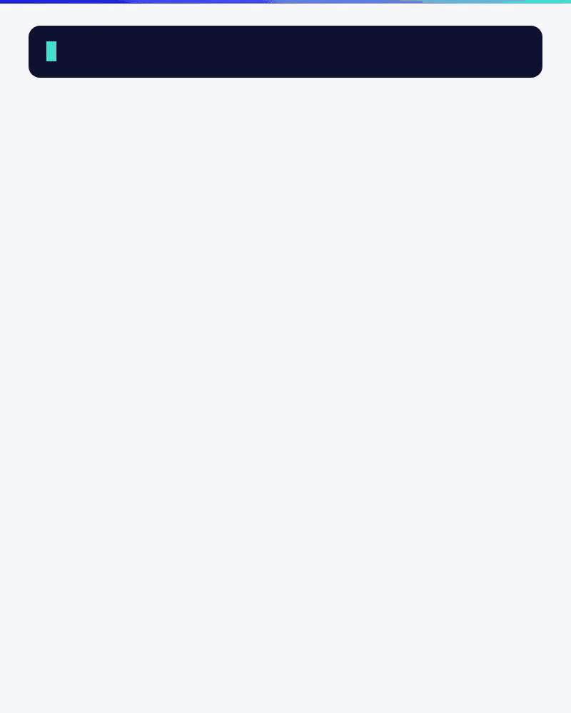
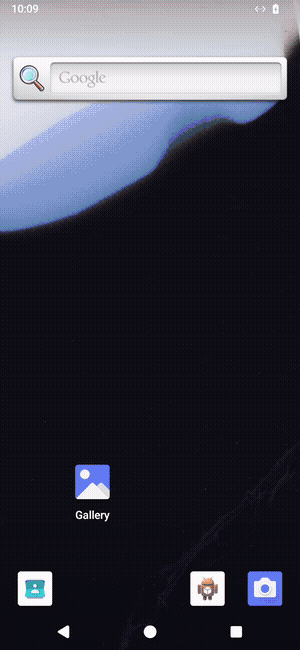
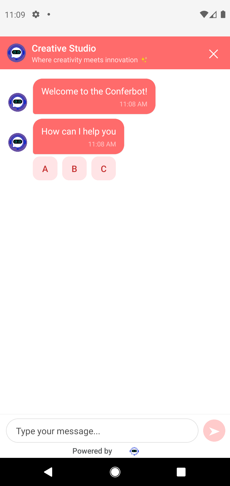

# Conferbot React Native SDK

[](https://www.npmjs.com/package/@conferbot/react-native)
[](https://reactnative.dev/)
[](https://www.typescriptlang.org/)
[](LICENSE)

Add your Conferbot chatbot, live chat and help centre to an iOS and Android React Native app. Every screen is a native view, with no WebView. The bot runs the flows, AI agents and live chat you build in the Conferbot dashboard, and they work the same as in the web widget.

<!-- TODO(video): record the quickstart (install, find the bot ID, add the launcher, sign a user in), save it as docs/media/quickstart.gif and replace VIDEO_ID with the YouTube video id. -->
<p align="center">
  <a href="https://youtu.be/VIDEO_ID"></a>
  <br />
  <a href="https://youtu.be/VIDEO_ID">Watch the quickstart on YouTube</a>
</p>

**Contents:** [Requirements](#requirements) · [Install](#install) · [Get your bot ID](#get-your-bot-id) · [Add the chat](#add-the-chat) · [Sign users in](#sign-users-in) · [Push notifications](#push-notifications) · [Customising](#customising) · [Help centre](#help-centre) · [Your requests](#your-requests) · [In the conversation](#in-the-conversation) · [API reference](#api-reference) · [Troubleshooting](#troubleshooting) · [Example app](#example-app) · [Contributing and testing](#contributing-and-testing)

## See it in action

This is the complete flow, recorded live on an Android emulator against production:

1. The floating widget opens with its server-configured CTA tooltip.
2. The bot loads with the server's theming and shows its welcome message, with a GIF below the text bubble.
3. The visitor's name is captured through the inline input.
4. The visitor picks a choice. The transcript stays intact: the selected pill stays highlighted and the rest are disabled.
5. The follow-up steps run.

<p align="center">
  
</p>

<p align="center"><a href="docs/demo.mp4">HD video (MP4)</a></p>

<p align="center">
  
  
  
</p>

## Features

- **Native components**: built entirely with React Native views, not a WebView wrapper.
- **Floating launcher**: the same bottom-corner bubble as the web widget, with its greeting card, icons, motion and mascot, all driven by your dashboard settings.
- **Flows as on the web**: all 82 step types of the flow builder (questions, choices, conditions, loops and sub-flows, AI route / extract, knowledge-base answers, OTP, consent, payment and more). They are checked against 156 shared cases produced by running the widget's own code.
- **AI agents**: streamed replies, starter and follow-up questions, sources, and "Helpful?" under each answer. Replies render tables, headings, quotes and code.
- **Live chat**: the handover to your team, the queue with its wait, leave a message, the post-chat rating, and "Email me this chat". A live chat is picked back up after an app restart.
- **While you wait**: help articles and seven small games while the visitor waits for a person.
- **Home screen, help centre and "Your requests"**: the web widget's home screen, help articles and the visitor's own conversations with your team.
- **Your look and language**: 27 widget themes with dark mode, plus your colours, fonts and sounds. The SDK's words are in English, Dutch, French, German or Spanish.
- **Signed-in users**: identity verification with a server-made hash.
- **Push notifications**: opt-in. You pass your FCM / APNs token, and a tapped notification opens its conversation. The SDK has no Firebase dependency.
- **Session persistence**: conversations survive app restarts (with AsyncStorage).
- **Reactions, read receipts, attachments, voice notes and analytics**.
- **TypeScript**: complete type definitions for every export.

## Requirements

| | Minimum |
|---|---|
| React | 17.0.0 (`peerDependencies`) |
| React Native | 0.70.0 (`peerDependencies`) |
| iOS / Android | Whatever your React Native version requires. The SDK adds no native code of its own, so it raises neither minimum. For React Native 0.70 that is iOS 12.4 and Android 5.0 (API 21). |
| Expo | Works in Expo and bare React Native apps. The SDK is plain TypeScript. |

The SDK talks to `https://wdt.conferbot.com` over HTTPS and WebSockets, so the device needs network access to it.

## Install

```bash
npm install @conferbot/react-native
# or
yarn add @conferbot/react-native
```

`axios` and `socket.io-client` come with it. The SDK has no native code, so there is no linking step and no `pod install` for the SDK itself.

### Optional packages

Each package below switches on one feature. Without it, that feature is simply left out and the SDK still works. Install only what you need:

| Package | What it enables |
|---|---|
| `@react-native-async-storage/async-storage` (>= 1.17) | Keeps the conversation across app restarts. Also needed for "Your requests", the "Welcome back" home card, the Sound on / off choice and "once per conversation" rules. The SDK finds it when it is installed, so you don't pass anything. |
| `react-native-svg` (>= 12) | Launcher icons, gradients, effects and the mascot, chat background gradients and patterns, the signature pad, and the pencil and mascot typing styles. Without it, the SDK uses plain colours, the dots typing style and a typed name for signatures. |
| `expo-av` | The owner's message sounds, sound pack and launcher sound (without it, the chat is silent). Also voice notes. |
| `expo-file-system` | Plays the synthesised sounds on iOS. Without it, the launcher sound still plays, and the synthesised tones play on Android only. |
| `expo-font` | Loads the owner's Google font and the widget theme's font at run time. Without it, the chat uses the platform font. A system font the owner picked (Georgia, Verdana...) is still used by name. |
| `@react-native-community/netinfo` | The device's own network in `isOnline` (without it, `isOnline` is the socket's state), and `useNetworkStatus()`. |
| `react-native-document-picker` + `react-native-image-picker`, or `expo-document-picker` + `expo-image-picker` | Attachments (`enableAttachments`): files, the photo library and the camera. |
| `react-native-audio-recorder-player` (or `expo-av`) | Voice notes (`enableVoiceMessage`). |

```bash
# The usual set
npm install @react-native-async-storage/async-storage react-native-svg

# Sounds and fonts (Expo modules)
npx expo install expo-av expo-file-system expo-font
```

**iOS.** The optional packages are native modules. After adding any of them, run:

```bash
cd ios && pod install && cd ..
```

**Expo modules in a bare React Native app.** `expo-av`, `expo-file-system` and `expo-font` need the Expo modules runtime. Run `npx install-expo-modules@latest` once, then `npx expo install ...` as above.

**Android.** There is no Gradle change for the SDK. Rebuild the app after adding a native package (`npx react-native run-android`).

**Permissions.** The SDK doesn't use these permissions unless you turn the feature on. With `enableAttachments` or `enableVoiceMessage`, add the usage strings that the picker and recorder libraries ask for:

- iOS: `NSPhotoLibraryUsageDescription`, `NSCameraUsageDescription` and `NSMicrophoneUsageDescription`.
- Android: `RECORD_AUDIO`.

## Get your bot ID

The bot ID is the only credential the app needs.

1. Sign in to the [Conferbot dashboard](https://app.conferbot.com) and open **Chatbots**.
2. On your bot's card, open the **⋯** menu and choose **Install on your site**.
3. Scroll to **Mobile apps** ("Run the same chatbot natively in your iOS, Android, React Native or Flutter app") and pick **React Native**. The install line and an `App.tsx` snippet are shown, with your bot ID already filled in.

For an AI agent built in Agent Studio, the **Deploy** tab has the same **Mobile apps** section. You can also find the bot ID in two other places:

- **Copy chatbot ID** in the bot list of the Inbox.
- The 24-character id in the dashboard's address bar (`.../chatbot/<botId>/...`).

`apiKey` is required by the provider, but the mobile API doesn't check it today. Any value works, and the dashboard's snippet uses `conf_test_key`.

> **No account yet?** The public demo bot `691c970890527a0468f9b2c9` works without an account. Use it as `botId` to try the SDK right away.

Publish the bot in the dashboard: an unpublished bot has no flow to run.

## Add the chat

Wrap your app in `ConferBotProvider` once, near the root. Then pick how the chat appears. Every sample below compiles against this version of the SDK.

### Floating launcher (recommended)

`ConferBotWidget` is the web widget's launcher: a bubble in the bottom corner that opens the chat full screen. It positions itself absolutely, so put it last inside a full-screen view.

```tsx
import React from 'react';
import { View, Text } from 'react-native';
import { ConferBotProvider, ConferBotWidget } from '@conferbot/react-native';

export default function App() {
  return (
    <ConferBotProvider apiKey="conf_test_key" botId="YOUR_BOT_ID">
      <View style={{ flex: 1 }}>
        <Text>Your app</Text>
        <ConferBotWidget />
      </View>
    </ConferBotProvider>
  );
}
```

The launcher reads your dashboard settings: colour or gradient, icon, size, side, offsets, shape, style, greeting card and motion. You don't need any styling code to match your web widget. Each value can be overridden in `widgetConfig`, and a local value wins over the dashboard:

```tsx
<ConferBotWidget
  title="Support"
  enableAttachments
  showTimestamps
  widgetConfig={{
    position: 'left',
    offsetX: 16,
    offsetBottom: 96, // above your tab bar
    size: 56,
    backgroundColor: '#0808EE',
    iconColor: '#ffffff',
    ctaText: 'Questions? Ask us',
    showCta: true,
  }}
/>
```

`widgetConfig` also takes `borderRadius`, `themeType` (`'solid'` / `'gradient'`), `gradientColorStart`, `gradientColorEnd`, `iconName`, `iconImageUrl`, `iconScale` and `showShadow`. `ConferBotWidgetProps` extends `ChatWidgetProps`, so the chat's own props (`title`, `placeholder`, `enableAttachments`, `enableVoiceMessage`, ...) pass straight through.

Inside the provider, the launcher's chat follows the provider's open state: `openChat()` and `closeChat()` from `useConferBot()`, from any screen, open and close it, and so does a [push notification](#push-notifications) tap. Tapping the launcher calls them too.

### Full screen, from your own button

`ChatWidget` is the chat itself, presented as a full-screen modal that slides up. Give it `visible` and `onClose` to open it from your own button:

```tsx
import React, { useState } from 'react';
import { Button } from 'react-native';
import { ChatWidget } from '@conferbot/react-native';

export function HelpButton() {
  const [open, setOpen] = useState(false);
  return (
    <>
      <Button title="Chat with us" onPress={() => setOpen(true)} />
      <ChatWidget visible={open} onClose={() => setOpen(false)} />
    </>
  );
}
```

A `ChatWidget` without `visible` opens as soon as it mounts and stays open. Use that only on a screen that is nothing but the chat.

### Open it from anywhere

To open the chat from any screen, or from a [push notification](#push-notifications) tap, call `openChat()` wherever you need it. With the [floating launcher](#floating-launcher-recommended) mounted, that is all: its chat follows the provider's open state. Without the launcher, mount one `ChatWidget` that follows it:

```tsx
import React from 'react';
import { Button } from 'react-native';
import { ConferBotProvider, ChatWidget, useConferBot } from '@conferbot/react-native';

// Mount once, near the root, inside the provider.
function Chat() {
  const { isOpen, closeChat } = useConferBot();
  return <ChatWidget visible={isOpen} onClose={closeChat} />;
}

// Anywhere below the provider.
function OrderHelp() {
  const { openChat, unreadCount } = useConferBot();
  return <Button title={unreadCount ? `Support (${unreadCount})` : 'Support'} onPress={openChat} />;
}

export default function App() {
  return (
    <ConferBotProvider apiKey="conf_test_key" botId="YOUR_BOT_ID">
      <OrderHelp />
      <Chat />
    </ConferBotProvider>
  );
}
```

Mount either the launcher or this `ChatWidget`, not both: both follow `isOpen`, so both would open.

### Home screen

When the owner turns on the home screen (dashboard: Customize > Welcome > Home screen), every option above opens on it: the launcher, `ChatWidget` and `openChat()`. From there the visitor can ask a question, open help articles, see "Your requests" or start a chat. You don't need any code for this.

To put the home screen in a tab of your own, draw `<HomeScreen />` and let the conversation slide over it:

```tsx
import React from 'react';
import { View } from 'react-native';
import { ChatWidget, HomeScreen, Mascot, useHome } from '@conferbot/react-native';

// A "Support" tab: the owner's home screen, the conversation over it.
export function SupportTab() {
  const { model, view, showHome } = useHome();
  if (!model) return <ChatWidget visible onClose={() => {}} />; // home screen off in the dashboard
  return (
    <View style={{ flex: 1 }}>
      <HomeScreen renderMascot={(m) => <Mascot look={m.look} accent={m.accent} mood="wave" />} />
      <ChatWidget visible={view !== 'home'} onClose={showHome} />
    </View>
  );
}
```

`useHome()` returns:

- `model`: what the home screen shows, or `null` when the owner has none.
- `view`: `'home'`, `'chat'` or `'help'`.
- `showHome()`, `showChat(text?)` (with `text`, the question is asked in the chat), `showHelp(categoryId?)`, `openArticle(id)` and `openRequests(id?)`.

The [Home screen settings](#home-screen-settings) table lists what the owner controls.

### Your own UI (headless)

`useConferBot()` gives you the connection state, the message record and every action:

```tsx
import React from 'react';
import { View, Text, Button, FlatList } from 'react-native';
import { ConferBotProvider, useConferBot } from '@conferbot/react-native';

function ChatScreen() {
  const { sendMessage, record, isConnected } = useConferBot();

  return (
    <View style={{ flex: 1 }}>
      <Text>{isConnected ? 'Connected' : 'Connecting...'}</Text>
      <FlatList
        data={record}
        keyExtractor={(item) => String(item._id)}
        renderItem={({ item }) => <Text>{'text' in item ? item.text : item.type}</Text>}
      />
      <Button title="Send Hello" onPress={() => sendMessage('Hello!')} />
    </View>
  );
}

export default function App() {
  return (
    <ConferBotProvider apiKey="conf_test_key" botId="YOUR_BOT_ID">
      <ChatScreen />
    </ConferBotProvider>
  );
}
```

### Mix and match

You can also compose the SDK's own pieces inside your layout:

```tsx
import React from 'react';
import { View } from 'react-native';
import {
  ConferBotProvider,
  useConferBot,
  MessageList,
  ChatInput,
  ChatHeader,
  ConnectionStatus,
} from '@conferbot/react-native';

function CustomChat() {
  const { record, sendMessage, isConnected } = useConferBot();

  return (
    <View style={{ flex: 1 }}>
      <ChatHeader title="Support" />
      <ConnectionStatus variant="badge" />
      <MessageList messages={record} />
      <ChatInput onSend={sendMessage} disabled={!isConnected} />
    </View>
  );
}

export default function App() {
  return (
    <ConferBotProvider apiKey="conf_test_key" botId="YOUR_BOT_ID">
      <CustomChat />
    </ConferBotProvider>
  );
}
```

Other building blocks: `MessageBubble`, `Avatar`, `TypingIndicator`, `EmptyState`, `OfflineBanner`, `MessageStatusIndicator`, `ReactionPicker`, `MessageReactions`, `LinkPreview`, `EmojiPicker`, `NodeRenderer`, `Mascot`, `HomeScreen`, `RequestsPortal`, `WaitHelpCard` and `GamesCard`.

## Sign users in

Pass your signed-in user as `user`. Conversations, contacts and answer variables are then filed under them. The user (with `metadata`) goes with every conversation record, as with the web widget, so dashboard contacts and greeting rules ("signed in") see it.

```tsx
import React from 'react';
import { ConferBotProvider, ConferBotWidget, type ConferBotUser } from '@conferbot/react-native';

type Session = { id: string; name: string; email: string; conferbotHash: string } | null;

export function Root({ session }: { session: Session }) {
  // Signed out: no `user`. Signed in: the user, with the hash your server made.
  const user: ConferBotUser | undefined = session
    ? {
        id: session.id,
        name: session.name,
        email: session.email,
        hash: session.conferbotHash,
        metadata: { plan: 'pro' },
      }
    : undefined;

  return (
    <ConferBotProvider apiKey="conf_test_key" botId="YOUR_BOT_ID" user={user}>
      <ConferBotWidget />
    </ConferBotProvider>
  );
}
```

`ConferBotUser` requires `id`. `name`, `email`, `phone`, `hash` and `metadata` are optional. `{{first_name}}`, `{{name}}` and `{{company}}` in the owner's texts are filled in from `user.name` and `user.metadata`.

### Identity verification

Without verification, any app could claim any id or email. To turn it on:

1. In the dashboard, open **Workspace settings > Team & security > Security > Identity verification**. Copy the secret there, and turn on **Require verification** if anonymous chats should not be filed under a claimed id.
2. Sign each user on your server: an HMAC-SHA256 of the user's `id`, hex-encoded.
3. Send the result to the app with your own session data, and pass it as `user.hash`.

```js
// server.js (Node, on your server: never ship the secret in the app)
const crypto = require('crypto');

function conferbotHash(userId) {
  return crypto
    .createHmac('sha256', process.env.CONFERBOT_IDENTITY_SECRET)
    .update(String(userId))
    .digest('hex');
}

// e.g. with Express, after your own login check:
// app.get('/api/me', requireLogin, (req, res) => {
//   res.json({ id: req.user.id, name: req.user.name, email: req.user.email, conferbotHash: conferbotHash(req.user.id) });
// });
module.exports = { conferbotHash };
```

The server checks the hash against `id` (or `email` when there is no id). A matching hash files the chat under that user, and their contacts link and merge. A missing or wrong hash makes the visitor unverified. With **Require verification** on, a wrong hash makes the visitor anonymous instead. A verified user also sees their conversations from any device in "Your requests".

### Sign out

Drop `user` from the provider. The SDK then stops this device's pushes for the old conversation. To also forget the conversation kept on the device, so that the next person on this phone starts fresh:

```tsx
import { useConferBot } from '@conferbot/react-native';

export function useSignOut(clearSession: () => void) {
  const { clearPersistedData, resetConversation } = useConferBot();
  return async () => {
    await clearPersistedData(); // forget the conversation kept on this device (and stop its pushes)
    await resetConversation();  // clear the one on screen
    clearSession();             // then drop `user` from the provider
  };
}
```

## Push notifications

When an agent or the AI replies while the visitor is not in the chat (the app is in the background or closed), the Conferbot server can send a push: FCM on Android, APNs on iOS. The SDK doesn't depend on Firebase or any push library, and push stays off until your app hands it a token.

1. Get the token with your push library. For example, `@react-native-firebase/messaging` gives an FCM token on both platforms with `messaging().getToken()`. You can also use the APNs device token as hex.
2. Pass the token to the SDK. It is registered with the current conversation (`POST /api/v1/mobile/push/register` with `chatSessionId` and `tokenType`), and again for each new conversation. It is unregistered when your `user` goes away (logout), on `clearPersistedData()` and on `unregisterPush()`.
3. Forward notifications to `handlePushNotification`. It returns `true` when the notification is this bot's Conferbot message, and opens its conversation: the chat, or that conversation in "Your requests". The chat opens with `openChat()`: the floating `ConferBotWidget` opens, or a `ChatWidget` rendered as in [Open it from anywhere](#open-it-from-anywhere).

```tsx
import { useEffect } from 'react';
import messaging from '@react-native-firebase/messaging';
import { useConferBot } from '@conferbot/react-native';

export function ConferbotPush() {
  const { setPushToken, handlePushNotification } = useConferBot();

  useEffect(() => {
    messaging().getToken().then((t) => setPushToken(t, 'fcm'));
    const offRefresh = messaging().onTokenRefresh((t) => setPushToken(t, 'fcm'));
    // Tapped while in the background / from a cold start.
    const offOpened = messaging().onNotificationOpenedApp((m) => handlePushNotification(m));
    messaging().getInitialNotification().then((m) => m && handlePushNotification(m));
    // Arrived in the foreground: count it as unread instead of taking the screen.
    const offMessage = messaging().onMessage((m) => handlePushNotification(m, { open: false }));
    return () => { offRefresh(); offOpened(); offMessage(); };
  }, []);
  return null;
}
```

Render `<ConferbotPush />` inside the provider.

- **`setPushToken(token, type?)`**: `type` is `'fcm'` or `'apns'`. An iOS app using Firebase Messaging passes `'fcm'`. Without a type, a 64-character hex token is taken as APNs. `setPushToken(null)` unregisters.
- **`handlePushNotification(data, { open? })`** takes the data map or the library's message object: RNFirebase `RemoteMessage`, Notifee's `notification`, Expo's notification or response, or iOS `userInfo`.
- **Outside the provider**, `isConferbotPush(data)` and `parseConferbotPush(data)` tell you whether a notification is Conferbot's. Its data carries `source: "conferbot"`, `type: "conferbot_message"`, `botId`, `chatSessionId`, `messageId`, `senderType`, `senderName` and `body`.
- **Android channel**: the server sends on the channel `conferbot_messages` (`PUSH_CHANNEL_ID`). Create it in your app (for example with Notifee) so the visitor can control it. Otherwise Android uses its fallback channel. There is one notification per conversation: the collapse key / tag and iOS `thread-id` are the conversation.
- **`registerPushToken(token)`** still works but is deprecated: it is `setPushToken(token)`.

**On the server.** Sending stays off until the workspace's embed-server has `MOBILE_PUSH_ENABLED=true` and the FCM / APNs credentials (embed-server `docs/mobile-push.md`). For now the credentials are platform-wide, so pushes reach only apps built on Conferbot's Firebase project and bundle id. Your own app's Firebase project or bundle id needs per-workspace credentials, which are not built yet (embed-server #197). Until then, your app's tokens register, but FCM / APNs refuse its pushes. See [Troubleshooting](#push-notifications-dont-arrive).

## Customising

### What the dashboard controls, what your code controls

Most of the chat's look and behaviour is the bot owner's, set in the dashboard. The SDK applies those settings by itself, so the app and the web widget look the same:

| In the dashboard (no code) | In your code |
|---|---|
| Theme (27 themes; light, dark or follow the phone), colours, bubble and avatar shapes, chat background, font | Where the chat appears: [launcher, full screen, from anywhere, home tab](#add-the-chat) |
| Launcher: icon, colour or gradient, size, side, offsets, shape, style, motion, entrance, attention, idle call, mascot | `widgetConfig` overrides for the launcher (local values win) |
| Greeting card: style, text, delay, rules, frequency | `user`: who the visitor is, and `user.hash` |
| Home screen, help centre, "Ask anything", reply time, waiting games | `config.widgetLanguage`: force a language |
| Widget language (`widgetLanguage`) | `config.onPostChatRedirect` / `disablePostChatRedirect` |
| Sounds, human touches, auto-open, typing preview | Push: `setPushToken`, `handlePushNotification` |
| Post-chat rating, survey questions, post-chat redirect | `ConferBotEndpoints`: your own server |
| The flow, the AI agent, handover rules | `ThemeProvider` for components you compose yourself |

Changes in the dashboard reach the app the next time it connects: no app release is needed.

### Provider options

```tsx
import React from 'react';
import { ConferBotProvider, ConferBotWidget } from '@conferbot/react-native';

declare const navigation: { navigate: (screen: string, params: object) => void };

export const App = () => (
<ConferBotProvider
  apiKey="conf_test_key"
  botId="YOUR_BOT_ID"
  config={{
    widgetLanguage: 'auto',          // or 'en' | 'nl' | 'fr' | 'de' | 'es'
    enablePersistence: true,         // keep the conversation across launches (needs AsyncStorage)
    enableReadReceipts: true,
    autoConnect: true,
    // The owner's post-chat redirect: open it in your own screen instead.
    onPostChatRedirect: (url) => {
      navigation.navigate('Web', { url });
      return true; // handled: no countdown, no browser
    },
    // disablePostChatRedirect: true, // or never follow it
  }}
>
  <ConferBotWidget />
</ConferBotProvider>
);
```

`ConferBotProvider` props: `apiKey: string`, `botId: string`, `config?`, `customization?`, `user?: ConferBotUser` and `children`.

| `config` option | Type | What it does |
|---|---|---|
| `widgetLanguage` | `'auto' \| 'en' \| 'nl' \| 'fr' \| 'de' \| 'es'` | The language of the SDK's own words. It wins over the owner's setting (see [Languages](#languages)). |
| `onPostChatRedirect` | `(url: string) => boolean \| void` | Gets the owner's post-chat redirect before the countdown. Return `true` when the app handled the URL (or wants none), and no countdown is shown. |
| `disablePostChatRedirect` | `boolean` | Never follow the owner's post-chat redirect (default `false`). |
| `enablePersistence` | `boolean` | Keep the conversation across app restarts. The default is `true` when AsyncStorage is installed or passed. `false` keeps nothing on the device. |
| `asyncStorage` | `AsyncStorageInterface` | Your own storage. The installed `@react-native-async-storage/async-storage` is used when this is not set. |
| `persistenceConfig` | `PersistenceConfig` | `maxMessages`, `keyPrefix`, `enabled`, `sessionExpiryMs`. |
| `enableReadReceipts` | `boolean` | Read receipts (default `true`). |
| `readReceiptConfig` | `ReadReceiptConfig` | `enabled`, `showIndicators`, `batchDebounceMs`, `autoMarkAsRead`. |
| `autoConnect` | `boolean` | Connect the socket on mount (default `true`). |
| `reconnectionAttempts` | `number` | How many times the socket tries to reconnect after losing the server (default `5`; `0` never retries). |
| `reconnectionDelay` | `number` | The first wait before a reconnect, in ms (default `1000`, doubling up to 5 s). |
| `enableOfflineMode` | `boolean` | A message sent while offline waits and is sent on reconnect (default `true`). `false`: it is not sent. See [Offline support](#offline-support). |
| `offlineQueueConfig` | `OfflineQueueConfig` | The offline queue: `maxQueueSize` (50), `maxRetries` (5), `initialRetryDelay`, `maxRetryDelay`, `backoffMultiplier`, `persistQueue` (default `true`: kept on the device when AsyncStorage is there), `keyPrefix`, `autoProcess`. |
| `enableNotifications` | `boolean` | Deprecated, no effect (a development warning says so). Push is switched on by `setPushToken` and off by `unregisterPush`. |

The `customization` prop (`ConferBotCustomization`) is accepted for forward compatibility, but the built-in UI doesn't apply it. Use the dashboard, or `ThemeProvider` for your own components.

### Languages

The SDK draws its own words in English, Dutch, French, German or Spanish, as the web widget does. That covers buttons, hints, errors, the handover lines, the queue card, the help centre, "Helpful?", the requests, the home screen, the games, the greeting card, the step cards and their checks, and "5 min ago".

The language is chosen in this order:

1. `config.widgetLanguage`, when you set it.
2. The owner's choice in the dashboard (`widgetLanguage`).
3. With "auto", or a bot that never chose: the phone's first supported language.
4. Otherwise English.

What the owner wrote (greetings, messages, buttons in the flow) is shown as written. The stock English defaults that a new bot comes with ("Hi there 👋") are translated.

```tsx
import { t, widgetLanguage, useConferBot } from '@conferbot/react-native';

export function useLabels() {
  const ctx = useConferBot();
  return {
    send: t('chat.composer.send'), // "Senden" when the chat is in German
    language: ctx.widgetLanguage,  // 'de'
    current: widgetLanguage(),
  };
}
```

### Fonts and sounds

- **Font**: the owner's font (any of the dashboard's Google fonts) wins, for all text. Otherwise the theme's font is used: for all text in "body" themes, or only for the header title and headings in "display" themes. The font is fetched from Google Fonts and registered with `expo-font` at run time, under a "CB Font" name that your app's own text never picks up. It applies to the bubbles, the agent's formatted replies, the composer, the header, the home screen, and the step cards' buttons and fields. The older built-in node components, handover panels and help-centre screens keep the platform font. This needs `expo-font`.
- **Sounds**: the chat plays the owner's choices: `messageSound` (pop, chime or bubble), a `soundPack` (soft, playful, retro, bubbly or premium) for opening, a message, sending and closing, and the launcher sound file.
  - These are the web's own tones, rendered on the phone. At most one message sound plays every 0.8 s.
  - The chat menu has Sound on / off when the bot has a sound, and the choice is kept on the device.
  - On iOS, the ring / silent switch silences them. On Android, they follow the media volume.
  - This needs `expo-av` (and `expo-file-system` on iOS).

### Redirect after chat

When the owner sets a URL in Customize > Conversations > Post-chat redirect, the SDK follows it as the web widget does:

1. The conversation ends: the flow reaches its end, or an agent ends the chat.
2. The post-chat rating is sent or put away. When the owner has post-chat feedback on, the rating is offered 1.5 s after the flow ends, and when an agent ends the chat. It is offered once per conversation, and not again after a restart.
3. A quiet line reads "Taking you to example.com in 10s", with Cancel.
4. The URL opens in the system browser (`Linking.openURL`).

The countdown stops if the visitor cancels, starts a new chat or closes the chat, or if the app goes to the background. The redirect is offered only once per conversation, and only `http(s)` addresses are followed. To open the URL in your own screen instead, use `config.onPostChatRedirect` (see [Provider options](#provider-options)). To never follow it, use `disablePostChatRedirect: true`.

### Theme and dashboard settings in detail

Everything you configure in the dashboard (Widget Customization / flow builder) is fetched at connect time and applied to the built-in chat UI, with no code:

- **Colours**: header background and text, bot bubble, user bubble, option bubble, chat background and base font size.
- **Identity**: the bot name in the header (the server's `botName` wins over the local `title` prop), the avatar image and the tagline.
- **Floating bubble**: drawn as the web widget draws it on a phone.
  - **Colour**: a solid colour, or a left-to-right gradient (with `react-native-svg`). The icon ink stays readable on light colours.
  - **Icon**: an SVG name or an uploaded image. All 56 dashboard launcher icons are drawn as on the web (with `react-native-svg`).
  - **Size and position**: the phone size and offsets (16px from the bottom and side unless set), and the side.
  - **Shape**: a speech bubble by default, or a circle, squircle, tab or peek.
  - **Style**: the icon, the bot's avatar with an online dot, the owner's mascot on a soft light button, or the label pill on tablets. Phones show the round button, as the web does.
  - **Greeting text**: shown only when the greeting is turned on.
  - **Motion**, as on the web: an idle moment about 2 s after the launcher shows and a few more after (`launcherAnimation` subtle / lively; off stops it), a reaction when a message arrives while the chat is closed, and the ripple rings. Nothing moves while the chat is open, after it was opened, or when the phone asks for reduced motion.
- **Launcher entrance, attention and idle call**: all off unless chosen in the dashboard, as on the web. Effects and the mascot need `react-native-svg`. Glows and blurs are left out, and nothing plays with reduced motion.
  - **Entrance**: plays the first time the launcher shows in an app session: lightning, rocket, portal, ufo, drop, confetti, coin, meteor, magic, parachute, plane or egg. The greeting waits until it has landed.
  - **Attention**: a "look here" loop on the launcher or the greeting card: pulse, wobble, bounce, wave, float, shine, heartbeat or orbit. It plays a beat, then stillness, until the chat is opened.
  - **Idle call**: after the chosen delay (12 s by default), the mascot slips out from behind the launcher and calls the visitor over with a bubble that opens the chat: psst, peek, wave, knock or tap. It plays at most twice a session, then rests for a few days.
- **Greeting card**: the dashboard greeting beside the launcher, as on the web.
  - **When it shows**: after its delay (3 s by default), when the greeting is on.
  - **Which message**: the highest-priority greeting rule that fits the app, else the default message. Rules can target every page, new or returning visitors, signed in or not, dates and visits. Page-specific, traffic-source and browsing rules are web-only.
  - **Smart greetings**: welcome back, and quiet for signed-in customers, with their show limits.
  - **Frequency**: every launch with a few minutes' rest after closing, once a session, or once in N days.
  - **A tap** opens the chat, sends the message as the visitor's first, or opens the rule's link. An AI agent's suggested questions show as chips.
  - **All 11 styles**: card, note, phone text (default), postcard, sticky note, typewriter, glass, notification, neon, voice note and aurora, with their reveals. The card uses the platform's fonts. Glass and notification are translucent without a live blur.
- **Mascot** (Customize > Launcher > Mascot): the owner's character. This needs `react-native-svg`, and nothing moves with reduced motion.
  - **Characters**: any of the 27 (10 originals and 17 industry ones: medic, tooth, piggy, shield, house, justice, bag, chef, suitcase, scholar, laptop, athlete, stylist, car, parcel, civic, heart).
  - **Looks**: its eyes (round, happy, sleepy, star, shades), accessory (headset, bow, cap, crown, flower, glasses), colour and name.
  - **As the launcher** (the mascot style): its head is drawn at `mascotLauncherScale`% (112 by default). It blinks, and hops happily when a reply arrives while the chat is closed.
  - **Elsewhere**: it greets on the greeting card in place of the avatar, by its name (`mascotInGreeting`). It types in the chat with the mascot typing style ("Pip is typing"). It is the one that calls in the idle call.
  - **Motion** (`mascotMotion`), for the greeting card and its figure:
    - **lively** (the default): the card springs up, and the figure pops in, waves, nods and breathes. It makes at most three small gestures, then stands still for good. The words fade up, and the "Online" dot pings once.
    - **subtle**: a rise, the ping and one tilt.
    - **off**.
  - **Leaving**: opening the chat from the card hands the figure off to the launcher. The × sends it off with a bow.
  - **On your own screens**: `<Mascot look accent mood />` draws it.
- **Typing indicator** (`typingStyle`): dots, an equaliser wave, a shimmering "Typing...", a pencil writing a line, or the mascot swaying beside three thought dots. The pencil and mascot need `react-native-svg`, and fall back to dots without it.
- **Chat background**: solid, gradient (linear, radial, mesh, blur), an image with its mask, or one of the 13 patterns. These are drawn with `react-native-svg` when it is installed, and as the base colour otherwise.
- **Widget theme**: all 27 dashboard themes (Classic, Minimal, Glass, Neo-brutal, Midnight, Aurora and the rest). Each brings its surfaces, text colours, corner radii and bubble outline, as on the web widget.
  - **Appearance**: light, dark, or auto (follows the phone's dark mode). Midnight, Neon, Chalkboard, Cyberpunk and Space are always dark.
  - **Colours**: "Brand" keeps your colours. "Theme palette" swaps in the theme's own header, bubble, option, launcher and send-button colours.
  - Your own bubble radius, option radius and chat background still win over the theme.
- **Human touches** (`botReactions`, `celebrations`, `stallNudges`, `allowChangeAnswer`): all on unless turned off. There are no confetti or sparks with reduced motion.
  - The bot taps back on an answer that deserves it: a wave for a name, a party for a booking or payment, and a heart, thumbs up or thank-you for a score.
  - A second of confetti plays for a booking, a payment or a perfect score, and sparks for a rating pick.
  - "No rush - ..." appears under a question that has waited 40 s with the chat on screen and nothing typed.
  - "Edit" appears under the visitor's latest answer and takes the conversation back to that question. It is offered only while nothing irreversible has happened since: a booking, a payment, a file or a person joining.
- **Auto-open** (`botAutoOpen`, `botAutoOpenDelay` seconds): the floating widget opens the chat on its own once per app launch. It does this only before the visitor has a conversation, and not within 2 minutes of them closing it.
- **Typing preview** (`visitorDraftPreview`, on unless turned off): while a person is chatting with the visitor, the agent sees what is being typed (`visitor-draft`, at most every 300 ms). It is never sent from a secure field.
- **Calendar**: slots already booked (the bot's bookings) show greyed out and can't be picked. A day with every slot taken is not offered.
- **Waiting for a person**: the wait card gives the live estimate in the visitor's language. Without one, it gives the team's usual wait ("Typical wait: a few minutes"), unless the owner hides the reply time. It also counts down the handover step's max wait ("Max wait 1:05"); after an app restart, it counts down from the server's time left.

### Which settings win

- **Floating bubble (`ConferBotWidget`)**: local `widgetConfig` props win over the server's dashboard values, which win over the SDK defaults. Anything you set explicitly wins.
- **Chat UI inside `ChatWidget`**: the widget wraps its content in an internal `ThemeProvider` seeded with the server theme, merged over the SDK's default theme. So for the drop-in chat, **the dashboard's colours win over a local `ThemeProvider`**. If your dashboard has no customizations, the default light theme is used.
- **Components you compose yourself** (`MessageList`, `ChatHeader`, ... in a custom layout) are styled by the nearest `ThemeProvider` you provide, which is fully under your control.

### Local themes (your own components)

The SDK ships `defaultTheme` (light) and `darkTheme`. `ThemeProvider` deep-merges a `ConferBotThemeOverride` over `defaultTheme`, so a partial override is fine:

```tsx
import React from 'react';
import { ThemeProvider, darkTheme, useTheme } from '@conferbot/react-native';

const CustomChat = () => null;

export const Dark = () => (
<ThemeProvider theme={darkTheme}>
  <CustomChat />
</ThemeProvider>
);

export const Brand = () => (
<ThemeProvider
  theme={{
    colors: {
      primary: '#4F46E5',
      userBubble: '#4F46E5',
      botBubble: '#F3F4F6',
    },
    borderRadius: { bubble: 12 },
  }}
>
  <CustomChat />
</ThemeProvider>
);

export function Swatch() {
  const theme = useTheme();
  return theme.colors.primary;
}
```

The full token set (`colors`, `typography`, `spacing`, `borderRadius`, `shadows`, `animations`, `layout`) is defined in the `ConferBotTheme` type.

### Your own server

By default the SDK talks to production at `https://wdt.conferbot.com` (REST base `https://wdt.conferbot.com/api/v1/mobile`). You can point it at a self-hosted, staging or local embed-server instead, before the provider renders:

```ts
import { ConferBotEndpoints } from '@conferbot/react-native';

// Before the provider renders, e.g. at the top of index.js / App.tsx.
if (__DEV__) {
  ConferBotEndpoints.configure({
    socketUrl: 'http://10.0.2.2:8001',                // Android emulator -> your machine's localhost
    apiBaseUrl: 'http://10.0.2.2:8001/api/v1/mobile',
  });
}
// ConferBotEndpoints.reset() restores https://wdt.conferbot.com
```

## Help centre

When the owner turns on the help centre (`enableKnowledgeBase`) and publishes articles, the help centre opens in the chat:

- from the home screen (topics, recent articles, "See all", search);
- from a help article that an AI reply cites;
- from an agent's article card;
- from the "While you wait" card.

An article with a public page opens in the browser when the help centre is off.

To open it from your own button, render the chat as in [Open it from anywhere](#open-it-from-anywhere), then:

```tsx
import React from 'react';
import { Button } from 'react-native';
import { useConferBot, useHome } from '@conferbot/react-native';

// With <Chat /> from "Open it from anywhere" mounted.
export function HelpCentreButton() {
  const { openChat } = useConferBot();
  const { showHelp } = useHome();
  return <Button title="Help centre" onPress={() => { showHelp(); openChat(); }} />;
}
```

`openArticle(articleId)` (on `useConferBot()` and `useHome()`) opens one article. `rateKBArticle(articleId, helpful, rating, feedback?)` sends the visitor's rating. Recent articles and categories arrive with the bot's data (`useConferBot().knowledgeBase`).

`KnowledgeBaseScreen`, `KBButton` and `ChatWidgetWithKB` are in the source tree under `src/components/KnowledgeBase/`, but they are **not exported from the package root**: treat them as unstable. `ChatWidgetWithKB` follows the owner's help centre switch. Its `enableKnowledgeBase` prop overrides the switch only when you set it (`true` or `false`). It browses your `kbCategories` when you pass any, and otherwise the bot's own published articles.

## Your requests

A visitor who has asked your team something can follow it up. They see the list of their requests, each one's conversation with the team, and a reply box. Team replies arrive live while a request is open. This is the web widget's "Your requests", and it appears in three places:

- a card on the [home screen](#home-screen), with up to two requests and "See all (n)", placed above "Talk to us" when a reply is new;
- the chat menu ("Your requests", once there is one), for bots without a home screen;
- your own UI:

```tsx
import React from 'react';
import { View, Button } from 'react-native';
import { useRequests, RequestsPortal } from '@conferbot/react-native';

function SupportButton() {
  const { requests, unread, open } = useRequests();
  if (!requests?.length) return null;               // a first-time visitor has none
  return <Button title={unread ? `Your requests (${unread} new)` : 'Your requests'} onPress={() => open()} />;
}

// Somewhere inside ConferBotProvider, filling the screen it is placed in:
export const RequestsScreen = () => (
<View style={{ flex: 1 }}>
  <SupportButton />
  <RequestsPortal />
</View>
);
```

`useRequests()` returns:

- `open(requestId?)`: opens the list, or one request;
- `back()` and `close()`;
- `refresh(force?)`: reads the list again (otherwise at most every 15 s);
- `state`, `isOpen`, `pick`, `setDraft`, `send`, `retry` and `reload`, for your own screens.

`useConferBot()` has the same as `requests`, `requestsUnread`, `openRequests`, `closeRequests`, `refreshRequests` and `requestsPortal`.

**Which requests are the visitor's.** The server lists a conversation only when both of these hold:

- its id is one this device started (kept per bot in AsyncStorage, the last 30);
- its visitor id matches.

A signed-in user with an [identity hash](#identity-verification) also sees their verified conversations from any device. Only conversations that a person on the team handled count. Replies are text only (the web has no attachments here either).

## In the conversation

You don't need any code for this section. It describes what the visitor sees, so you know what to expect.

### Home screen settings

| Setting | On the home screen |
|---|---|
| Home screen (`enableInitialPage`) | Off: no home at all, and the chat opens on the conversation. |
| Title, description, card title / tagline, button text, message | Shown as written. Early bots' placeholder copy ("Our usual reply time", "Later Today") is replaced with what is true. |
| "Ask anything" box (`homeAskBox`, on unless off) | With an AI agent: "Ask “...”" goes to the chat and asks it. The help articles that answer it are listed. For a flow bot, "Chat with us" when nothing matches. Off: the help card searches by itself. |
| Trust (`homeTeamPhotos`, `homeTrustLogos`, `homeTrustLabel`; `homeRating` from the server) | Up to 3 faces on "Talk to us", the real rating ("4.8 · 120 reviews"), and up to 6 logos with their line, shown once a logo has loaded. |
| Greet by name (`{{first_name}}`, `{{name}}`, `{{company}}`, or a fallback such as `{{first_name\|there}}`) | Filled in from `user.name` and `user.metadata` (and a name a flow asked for). Also used in the greeting card. |
| Recent articles (`enableKnowledgeBase`, `hideRecentArticles`) | The recent list, topics and "See all" (the help centre). None when the help centre is off or no article is published. |
| Hide online status (`hideOnlineStatus`) | No "Online" and no green dot. The reply-time words stay. |
| Reply time (`replyTime`) | "Online · Usually replies in a few minutes", "Team back tomorrow 9 AM", "Team replies by email", or nothing with Hide. |
| View transitions (`viewTransition`, `viewTransitionDirection`) | Fade and slide as on the web. Classic and none switch at once, and the other kinds slide. With reduced motion, the views fade. |

The visitor's first question and first name are kept on the device (per bot in AsyncStorage, forgotten after 60 days, never sent anywhere). They are used for "Welcome back, Jamie" and, for an AI agent bot, "Pick up where you left off". The chat header's ‹ goes back to the home screen, and so does Android's back button.

### Waiting for a person

- When an AI agent passes the visitor to the team, the chat shows "Connecting you with the team…" with typing dots, never "has left the chat". The line then settles to one of: "Connected with the team", "The team couldn't join just now", "You left the queue" or "Chat ended before the team joined".
- "Talk to a person" is offered only while no handover is under way and nobody is in the chat. It disappears once tapped. The owner's quick-action links stay.
- The header keeps the bot's name with "Online" and the team's reply time ("Typically replies in a few minutes", "Online · team back at 9 AM"). It goes back to "Online" when a person joins.
- Cancel on the wait card leaves the queue on the server (`queue-self-resolve`), so the team stops seeing the visitor waiting. `leaveQueue()` does the same from your own UI.
- After an app restart, the SDK asks the server where the chat stands (`live-chat-state`):
  - a chat with a person comes back live with its agent;
  - a visitor still in the queue goes back to the same wait;
  - a chat that ended meanwhile says so.
- When the agent leaves and the chat goes back to the queue, the chat shows "Connecting you to another agent..." (or "Connecting you to Sales..." after a team transfer). A flow at its handover step waits again. A transfer is kept in the conversation's record.
- When the agent ends a chat that a flow's handover step started, the flow carries on from that step. If the step has post-chat survey questions switched on (`enablePostChatSurveyQuestions`), they are asked one by one first. Each answer is kept in the conversation's record and its answer variable. Then the flow follows the step's next edge.
- If the same end arrives twice (for example, an agent's double click), the chat shows one "Chat ended" line and one survey. Once the chat has ended and nothing is going on, the composer turns off, and "Start a new chat" starts a fresh conversation.
- A visitor the workspace blocked sees "This conversation has been closed." This happens mid-chat or at connect (the visitor id goes with the socket handshake). They can't type or start a new chat.
- When an AI agent lets an idle visitor go (the agent's inactivity settings), the chat shows "Chat paused" with "Send a message to pick up where you left off". The composer stays on, and the visitor's next message brings the AI back. On a flow bot whose agent has "continue the flow" as its close action, the chat shows "Chat ended" instead, and the flow carries on from its handover step. An agent bot is always only paused.
- After an AI agent passes the visitor to the team, the server owns the wait. If nothing has come back from it within the handover step's max wait plus 30 seconds, the SDK nudges it (`handover-timeout`) and shows nothing itself.

### While you wait

The chat fills a wait for a person the way the web widget does. Nothing here is sent anywhere except "That solved it". The cards are never saved on the device or in the conversation's record.

- **Help articles**: 6 seconds into a wait, "While you wait, this might help" lists up to two help-centre articles that match the visitor's last real question. This applies to a handover with no AI agent first, or an AI passing the visitor on. It needs the help centre on (`enableKnowledgeBase`). A tapped article opens in the chat, and a page opens in the browser.
- **The server's pick**: when the server keeps a queue, it chooses the help itself (`queue-help`, at most two cards per wait). Its card has "That solved it". When tapped, the SDK sends `queue-self-resolve { chatSessionId, articleId }`. Once the server says ok, the visitor leaves the queue ("You left the queue. Glad that helped.") and the flow carries on. Once the wait is over, the card stays under "Articles that might help".
- **Games**: 2.5 seconds after `cb:waiting-for-human`, the card offers seven games:
  - rock paper scissors, tic-tac-toe, memory match, a reflex test, emoji riddles and a word scramble;
  - a quick quiz, with questions from your help centre when it is on.

  How the games behave:
  - Typing "play" or "games" while waiting opens the menu instead of sending the words.
  - "Not now" (or the ×) means no more offers for this app session.
  - When a person joins, an unused offer goes away, and a game in progress is saved ("Sam's here! Your game is saved - finish it later?", "Finish my game").
  - When the wait ends without anyone, an unused offer goes away, and a game being played stays.

  The owner sets `waitingGames: { enabled, games, offerText }` in the dashboard. Unset means on, with every game.

### Bot flows

The SDK runs a bot's flow the way the web widget does. The shared flow-node spec in `scripts/parity/flows/` is the reference. `__tests__/parity/flows.test.ts` runs all 156 of its cases through the engine, and `__tests__/components/FlowStepViews.test.tsx` plays the step-card cases on the cards themselves.

- **Routing**: the chat starts at the first welcome step. A step that doesn't branch follows its first edge. A branch (a choice, a condition, an AI intent) follows its own handle, and the chat ends when that handle has no edge. Unknown step types are passed along their first edge.
- **Answers**: a question with an answer variable saves into it, so `{name}`, `${name}` and `{{name}}` fill in later messages. An unknown variable shows nothing.
- **Server-side steps**: the GPT, AI route / extract, knowledge-base, OTP, address and payment steps call your bot's server (`/api/v1/bot/:id/...`). No secret ever reaches the device.
- **Integrations**: Gmail, Sheets, Slack, HubSpot and the rest run on the server with the step as it was saved, `credentialId` included. The flow moves on without waiting, except for Mailchimp, Segment and Salesforce, which wait and take their success or failure path.
- **Gates stay gates**: payment leaves by its paid path only when the server says paid. OTP leaves only once a code is verified, and required consent only once agreed.
- **Privacy**: card numbers, IBANs, ids and passwords in answers are masked before they are stored or sent (`redactSensitive`, on unless the owner turns it off).
- **Pacing**: typing dots last as long as the web's (`paceFor`). Pass `typingDelay` to `NodeFlowEngine` for a fixed delay instead. Images move on once they load, after 4 s at most.
- **No page in an app**: a hidden-fields step captures nothing, unless you run `NodeFlowEngine` yourself and pass `page: { url, referrer }` (for example, from a deep link).
- **Step cards**: the steps the web draws as cards have native cards under the bot's question, in the bot's option colours, corner radius and font size:
  - consent: a box to tick; the text's links open in the browser;
  - OTP: the e-mail, six digit boxes, Resend once its wait is over, Change email, and Skip when allowed;
  - address: suggestions as you type, then confirm; or the fields by hand;
  - signature: a pad to sign on with a finger (drawn with `react-native-svg`, sent as an SVG image), or the name typed;
  - ranking: drag a row by its handle, or move it with the arrows;
  - matrix: each row's columns, with how many rows are answered;
  - payment: Pay now opens Stripe Checkout in the browser, then I've paid and Cancel, with the time left;
  - slider, date / time, carousel and product cards (link buttons open their page; Continue when no card has a path), and picture choices.

  Without `react-native-svg`, the signature step takes the typed name. Each waiting state carries its step's `stepType` and `stepData` for custom renderers.

The engine also reports every step it enters, every handle it takes and the end, through `onTrace` (`FlowTraceEvent`).

### Reactions, read receipts and offline support

- **Reactions**: the built-in emoji set is `REACTION_EMOJIS` (👍 👎 ❤️ 😊 😮 😢), synced in real time. Use `addReaction(messageId, '👍')`, `removeReaction` and `getReactions` on `useConferBot()`. `ReactionPicker` and `MessageReactions` render them, and `useReactions()` adds `toggleReaction`, `getGroupedReactions` and `hasUserReacted` for your own UI.
- **Read receipts**: sent / delivered / read statuses update in real time (on by default; tune them with `config.readReceiptConfig`). Use `getMessageStatus`, `markMessageAsRead` and `markVisibleMessagesAsRead`. `MessageList` takes `messageStatuses` and `showReadReceipts`, and `MessageStatusIndicator` draws the ticks.
- <a id="offline-support"></a>**Offline support**: as on the web, a message the visitor sends while the connection is down waits, and is sent when the socket reconnects. The conversation's latest record goes once, carrying every message that waited. The queue is kept on the device when AsyncStorage is installed, so a message still waiting when the app closes goes at the next connect. `useConferBot()` gives you the state:
  - `isOnline`: the socket is connected and, with `@react-native-community/netinfo` installed, the device is online. Without NetInfo it is the socket's state alone.
  - `pendingMessageCount`: messages waiting to send.
  - `failedMessageCount`, `retryFailedMessage(messageId)`, `retryAllFailedMessages()` and `clearFailedMessages()`: a send that gave up after `offlineQueueConfig.maxRetries` tries.

  Turn the queue off with `config.enableOfflineMode: false`. The building blocks are exported for a UI of your own: `OfflineBanner` (a "you are offline" banner), `useNetworkStatus()` (needs NetInfo), and `useOfflineQueue()` / `OfflineQueueService`, a separate queue for your own sends.

```tsx
import React from 'react';
import { Button, Text, View } from 'react-native';
import { useConferBot } from '@conferbot/react-native';

export function ConnectionLine() {
  const { isOnline, pendingMessageCount, failedMessageCount, retryAllFailedMessages } = useConferBot();
  if (isOnline && !failedMessageCount) return null;
  return (
    <View>
      <Text>{isOnline ? 'Online' : `Offline: ${pendingMessageCount} waiting to send`}</Text>
      {failedMessageCount > 0 ? <Button title="Retry" onPress={() => retryAllFailedMessages()} /> : null}
    </View>
  );
}
```

### Analytics

Wrap your app with `ConferBotWithAnalyticsProvider` for session, message, step and drop-off tracking with batched uploads, and track your own events with `useAnalytics()`:

```tsx
import React from 'react';
import { ConferBotWithAnalyticsProvider, ChatWidget, useAnalytics } from '@conferbot/react-native';

export const App = () => (
<ConferBotWithAnalyticsProvider
  apiKey="conf_test_key"
  botId="YOUR_BOT_ID"
  config={{ enableAnalytics: true }}
  appVersion="1.4.2"
>
  <ChatWidget />
</ConferBotWithAnalyticsProvider>
);

export function useCheckoutHelp() {
  const { trackEvent } = useAnalytics();
  return () => trackEvent('checkout_help_opened', { screen: 'checkout' });
}
```

## API reference

### Components

| Export | Key props | What it is |
|---|---|---|
| `ConferBotProvider` | `apiKey`, `botId`, `config?`, `customization?`, `user?` | The root provider: socket, session, persistence and state (also the default export). |
| `ConferBotWithAnalyticsProvider` | provider props + `appVersion?`, `buildNumber?`, analytics `config` | The provider with analytics wired in. |
| `ConferBotWidget` | `widgetConfig?: WidgetConfig` + all `ChatWidgetProps` | The floating launcher, which opens the chat full screen. |
| `ChatWidget` | `visible?`, `onClose?`, `title?`, `placeholder?`, `enableAttachments?`, `enableVoiceMessage?`, `showTimestamps?`, `voiceMaxDuration?`, `voiceMinDuration?`, `debug?`, `testID?` | The chat as a full-screen modal: home screen, conversation and help centre. `closeOnBackdrop` and `typingDelay` are accepted but not used. |
| `HomeScreen` | `onClose?`, `renderMascot?`, `testID?` | The owner's home screen, for your own screens. It draws nothing when the owner has none. |
| `RequestsPortal` | `style?`, `testID?` | The "Your requests" screens (see `useRequests`). |
| `Mascot` | `look`, `accent`, `size?` (64), `mood?` (`idle`, `wave`, `think`, `happy`), `arm?`, `bust?`, `waveCount?` | The owner's mascot (`useConferBot().customizations.mascot`, or the home model's `mascot`). |
| `ChatHeader` | `title?`, `tagline?`, `subtitle?`, `showOnline?`, `statusText?`, `agent?`, `botAvatarUrl?`, `logoUrl?`, `hideLogo?`, `showConnectionStatus?`, `onBack?`, `onClose?`, `rightActions?` | The chat header. The built-in widgets keep the bot in it and never pass `agent`. |
| `MessageList` | `messages`, `showTypingIndicator?`, `showTimestamps?`, `reactions?`, `messageStatuses?`, `showReadReceipts?`, `activeNodeUI?`, `onNodeSubmit?`, `onEndReached?` | A virtualised message list that renders flow steps inline. |
| `ChatInput` | `onSend`, `placeholder?`, `disabled?`, `enableAttachments?`, `enableVoiceMessage?`, `enableEmoji?`, `maxLength?`, `onTyping?` | The composer, with attachments, emoji and voice. |
| `MessageBubble`, `ConnectionStatus`, `TypingIndicator`, `Avatar`, `EmptyState`, `OfflineBanner`, `MessageStatusIndicator`, `ReactionPicker`, `MessageReactions`, `LinkPreview`, `EmojiPicker` (+ `EmojiButton`, `EmojiGrid`, ...), `NodeRenderer`, `WaitHelpCard`, `GamesCard` | see each `*Props` type | Building blocks. |
| `ThemeProvider` | `theme?: ConferBotThemeOverride` | Deep-merges an override over `defaultTheme`, for your own components. |

### Hooks

| Hook | Returns |
|---|---|
| `useConferBot()` | The whole context: state and actions (below). |
| `useHome()` | `model`, `view`, `showHome`, `showChat(text?)`, `showHelp(categoryId?)`, `openArticle`, `openRequests`, `searchArticleText` |
| `useRequests()` | `requests`, `unread`, `state`, `isOpen`, `open`, `close`, `back`, `pick`, `reload`, `setDraft`, `send`, `retry`, `refresh` |
| `useTheme()` | `ConferBotTheme` |
| `useAnalytics(options?)` | `trackEvent`, `trackUserAction`, `trackNodeVisit`, `trackUserMessage`, ... |
| `useNetworkStatus(options?)` | `isConnected`, `isInternetReachable`, `type`, `isLoading`, `refresh()` (needs `@react-native-community/netinfo`) |
| `useOfflineQueue(options)` | `isOnline`, `queue`, `queueSize`, `pendingCount`, `failedCount`, `queueMessage`, `retryMessage`, `retryAllFailed`, `clearQueue`, `processQueue`, ... |
| `useReactions(...)`, `useReadReceipts(options)`, `usePersistence()`, `useDebouncedPersistence()` | See `UseReactionsReturn`, `UseReadReceiptsReturn`, `UsePersistenceReturn`. |

### useConferBot(): state

| Field | Type | Meaning |
|---|---|---|
| `isInitialized`, `isConnected`, `isOpen` | `boolean` | The SDK is ready, the socket is connected, the chat is open. |
| `isOnline`, `pendingMessageCount`, `failedMessageCount` | `boolean`, `number`, `number` | Online (socket and NetInfo), messages waiting to send, sends that gave up (see [Offline support](#offline-support)). |
| `chatSessionId` | `string \| undefined` | The current conversation. |
| `unreadCount` | `number` | Messages that arrived while the chat was closed. |
| `record` | `RecordItem[]` | The conversation. |
| `currentAgent` | `Agent \| undefined` | The person in the chat. |
| `isLiveChatMode`, `agentTyping` | `boolean` | A person has the chat, and is typing. |
| `botName`, `botAvatarUrl` | `string \| null` | From the dashboard. |
| `customizations`, `widgetTheme`, `widgetLanguage` | resolved settings | The owner's settings as applied, the theme in force, and the language in force. |
| `agentBot`, `agentStream`, `suggestions`, `awaitingReply` | | AI agent bots: the agent, the reply being written, the one-tap questions, and waiting for a reply. |
| `queue`, `handoverWaiting`, `waitEndsAt`, `noAgentsAvailable`, `visitorBlocked` | | The live-chat wait and its countdown. `visitorBlocked` is the closed line when the workspace blocked this visitor. |
| `homeView`, `knowledgeBase`, `requests`, `requestsUnread` | | Home, help centre and requests state. |
| `isRestoring`, `hasPersistedSession` | `boolean` | Persistence. |
| `reactions`, `messageStatuses`, `readReceiptsEnabled` | | Reactions and receipts. |
| `soundOn`, `hasSounds` | `boolean` | The visitor's Sound on / off, and whether the bot has a sound. |
| `postChatRedirect` | `RedirectLine \| null` | The redirect countdown line, when one is showing. |

### useConferBot(): actions

| Method | Signature | What it does |
|---|---|---|
| `openChat` / `closeChat` | `() => void` | Open or close the chat. Opening resets the unread count. |
| `sendMessage` | `(text: string, attachments?: MessageAttachment[]) => Promise<void>` | Send a message as the visitor. |
| `submitNodeResponse` | `(response: any, portName?: string) => void` | Answer the active flow step. |
| `setPushToken` | `(token: string \| null, type?: 'fcm' \| 'apns') => Promise<void>` | Register the device token with the conversation (`null` unregisters). |
| `handlePushNotification` | `(data: unknown, options?: { open?: boolean }) => boolean` | `true` for a Conferbot notification, and its conversation is opened. |
| `unregisterPush` | `() => Promise<void>` | Stop this device's pushes. |
| `registerPushToken` | `(token: string) => Promise<void>` | Deprecated: `setPushToken(token)`. |
| `on` / `off` | `(event: SocketEvents, cb) => () => void` / `void` | Raw socket events (see [Events](#events)). |
| `onWidgetSignal` | `(name, (detail) => void) => () => void` | The waiting signals (see [Events](#events)). |
| `leaveQueue` | `() => Promise<boolean>` | Leave the queue for a person (`queue-self-resolve`); the flow carries on. Returns `false` when a person already has the chat. |
| `openArticle` / `closeArticle` | `(id: string) => void` / `() => void` | A help article in the chat. |
| `showHome` / `showChat` / `showHelp` | see `useHome()` | Switch the open chat's view. |
| `openRequests` / `closeRequests` / `refreshRequests` | `(id?) => void` / `() => void` / `(force?) => Promise<void>` | "Your requests". |
| `openEmailTranscript` / `closeEmailTranscript` | `() => void` | Show or hide the "Email me this chat" card (the chat menu has it). |
| `emailTranscript` | `(email: string) => Promise<{ ok: boolean; message?: string }>` | Email the transcript. On success, the address is kept as the visitor's. |
| `submitRating` / `dismissCsat` | `(value: number \| boolean, feedback?: string) => void` / `() => void` | The post-chat rating. |
| `cancelPostChatRedirect` / `continuePostChatRedirect` | `() => void` | Cancel or continue the redirect countdown. |
| `toggleSound` | `() => void` | Sound on / off (kept on the device). |
| `addReaction` / `removeReaction` | `(messageId: string, emoji: ReactionEmoji) => void` | React to a message. |
| `getReactions` | `(messageId: string) => Reaction[]` | A message's reactions. |
| `getMessageStatus` | `(messageId: string \| number) => MessageStatus \| undefined` | Read-receipt status. |
| `markMessageAsRead` / `markVisibleMessagesAsRead` | `(id) => void` / `(ids) => void` | Mark inbound messages read. |
| `rateKBArticle` | `(articleId: string, helpful: boolean, rating: number, feedback?: string) => void` | Rate a help article. |
| `sendVisitorTyping` | `(isTyping: boolean) => void` | Send the visitor's typing status. |
| `clearPersistedData` / `resetConversation` | `() => Promise<void>` | Forget what is kept on the device / start a fresh conversation. |
| `retryFailedMessage` / `retryAllFailedMessages` / `clearFailedMessages` | `(messageId: string) => Promise<boolean>` / `() => Promise<number>` / `() => Promise<number>` | Try a failed send again, all of them, or drop them. |

### Events

Two kinds of events can be subscribed to from `useConferBot()`:

- **Socket events**: `on(event, callback)` returns an unsubscribe function. The event names are the `SocketEvents` enum (`SocketEvents.BOT_RESPONSE` is `'bot-response'`).
- **Waiting signals**: the same signals as the web widget, for your own waiting experience (a game, an article, a banner). `onWidgetSignal()` returns an unsubscribe function, and no detail carries personal data.

```tsx
import { useEffect } from 'react';
import {
  useConferBot,
  WAITING_FOR_HUMAN_EVENT,
  HUMAN_JOINED_EVENT,
  WAIT_OVER_EVENT,
  SocketEvents,
} from '@conferbot/react-native';

export function useChatEvents() {
  const { on, onWidgetSignal } = useConferBot();

  useEffect(() => on(SocketEvents.BOT_RESPONSE, (data) => console.log('bot', data)), [on]);

  useEffect(() => {
    const offs = [
      onWidgetSignal(WAITING_FOR_HUMAN_EVENT, (d) => console.log('waiting', d)), // { offline, reason, backAt, emailCaptured }
      onWidgetSignal(HUMAN_JOINED_EVENT, (d) => console.log('joined', d)),       // { name }
      onWidgetSignal(WAIT_OVER_EVENT, (d) => console.log('over', d)),            // { reason: 'unavailable' | 'cancelled' | 'ended' }
    ];
    return () => offs.forEach((off) => off());
  }, [onWidgetSignal]);
}
```

| Signal | When | Detail |
|---|---|---|
| `WAITING_FOR_HUMAN_EVENT` (`'cb:waiting-for-human'`) | 20 s into a wait with nobody yet (only while the chat is open), or the server says the team is busy or offline | `{ offline, reason, backAt, emailCaptured }` |
| `HUMAN_JOINED_EVENT` (`'cb:human-joined'`) | A person joined | `{ name }` |
| `WAIT_OVER_EVENT` (`'cb:wait-over'`) | The wait ended without one | `{ reason: 'unavailable' \| 'cancelled' \| 'ended' }` |

| Socket event | Sent when |
|---|---|
| `SocketEvents.BOT_RESPONSE` (`'bot-response'`) | The bot answered. |
| `SocketEvents.AGENT_MESSAGE` (`'agent-message'`) | A person wrote. |
| `SocketEvents.AGENT_ACCEPTED` (`'agent-accepted'`) | A person took the chat. |
| `SocketEvents.AGENT_LEFT` (`'agent-left'`) | The person left. |
| `SocketEvents.AGENT_TYPING_STATUS` (`'agent-typing-status'`) | The person is typing, or stopped. |
| `SocketEvents.CHAT_ENDED` (`'chat-ended'`) | The chat was ended. |
| `SocketEvents.CONNECTION_ERROR` (`'connection-error'`) | The socket couldn't connect. |

| Callback | Where | What it does |
|---|---|---|
| `onPostChatRedirect(url)` | `config` | The owner's redirect, before the countdown. Return `true` to handle it yourself. |
| `onClose()` | `ChatWidget` / `ConferBotWidget` | The visitor closed the chat. |
| `onTrace(event)` | `NodeFlowEngine` config | Each step entered, handle taken and the end (`FlowTraceEvent`). |

### Utilities

| Export | What it is |
|---|---|
| `ConferBotEndpoints` | `configure({ apiBaseUrl?, socketUrl? })` / `reset()`: endpoint overrides. |
| `isConferbotPush`, `parseConferbotPush`, `pushTokenTypeOf`, `PUSH_CHANNEL_ID` | Push helpers. |
| `t`, `tFor`, `widgetLanguage` | The SDK's words in the language in force. |
| `StorageService`, `OfflineQueueService`, `LinkPreviewService` / `linkPreviewService`, `AnalyticsService`, `getAnalyticsService()` | Services. |
| `FilePicker`, `formatFileSize`, `isFilePickerAvailable`, ... | Document, image and camera picking. |
| `detectUrls`, `parseTextForUrls`, `extractDomain`, ... | Link detection. |
| `NodeFlowEngine`, `ChatState`, `NodeHandlerRegistry`, `NodeTypes`, `registerAllHandlers` | The flow engine, for advanced use. |
| `defaultTheme`, `darkTheme`, `MessageStatus`, `REACTION_EMOJIS` | Themes and constants. |

## Troubleshooting

**The chat is empty, or the bot never answers**
- Check that the bot is **published** in the dashboard. An unpublished bot returns no flow.
- Check the `botId` against **Install on your site > Mobile apps** (see [Get your bot ID](#get-your-bot-id)). A wrong id fails silently, with an empty chat.
- Try the public demo bot `691c970890527a0468f9b2c9`. If it loads, the problem is your bot's set-up, not the SDK.
- Check that `https://wdt.conferbot.com` is reachable from the device or emulator. Corporate proxies, VPNs and emulator DNS are the usual suspects.

**The app can't reach a local server**
- Android emulator: your machine's `localhost` is `10.0.2.2`. You can also run `adb reverse tcp:8001 tcp:8001` and use `http://localhost:8001`.
- iOS simulator: `localhost` is your machine. A physical device needs your machine's LAN IP, on the same network.
- Configure both URLs: `socketUrl` and `apiBaseUrl` (which ends in `/api/v1/mobile`), before the provider renders.
- **Android cleartext**: a plain `http://` URL needs `android:usesCleartextTraffic="true"` on `<application>`, or a network security config, in a debug manifest.
- **iOS ATS**: React Native's template allows `localhost` (`NSAllowsLocalNetworking`). Any other plain `http://` host needs an `NSAppTransportSecurity` exception in `Info.plist`. Use HTTPS in release builds.

**Nothing is kept after a restart**
- Install `@react-native-async-storage/async-storage` and rebuild (`pod install` on iOS). Without it, nothing is kept, by design. Also check that you didn't pass `enablePersistence: false`.

**No sounds, no custom font, plain launcher icons**
- These come from optional packages: sounds need `expo-av` (and `expo-file-system` on iOS), fonts need `expo-font`, and icons, gradients and the mascot need `react-native-svg`. In a bare app, run `npx install-expo-modules@latest` first. Rebuild after installing.
- Sounds also respect the iOS silent switch, and the visitor's Sound off.

**Dashboard colours don't show**
- The settings arrive when the socket connects. Until then, and when it can't connect, the default theme is used. Inside the drop-in `ChatWidget`, server values win over a local `ThemeProvider` (see [Which settings win](#which-settings-win)).

**The chat is in the wrong language**
- The language follows the owner's `widgetLanguage`, and otherwise the phone's languages. Pass `config.widgetLanguage` to force one.

<a id="push-notifications-dont-arrive"></a>**Push notifications don't arrive**
- **No conversation yet**: a token is registered with a conversation, so nothing is registered before the visitor has one. It is registered once the visitor starts one.
- **Sending is off on the server**: sending stays off until the embed-server has `MOBILE_PUSH_ENABLED=true` and the FCM / APNs credentials. Its log says which platform is on.
- **Your own Firebase project or bundle id**: the credentials are platform-wide for now (embed-server #197). Your app's tokens register, but FCM / APNs refuse its pushes until per-workspace credentials exist.
- **iOS**: check `tokenType`. An FCM token from Firebase Messaging is `'fcm'`. A raw APNs token is `'apns'`, and the server needs `APNS_PRODUCTION=true` for TestFlight / App Store builds.
- **Android**: create the `conferbot_messages` channel.
- **The visitor is in the chat**: no push is sent while the visitor is in the chat.

**A notification tap doesn't open the chat**
- `handlePushNotification` opens the chat with `openChat()`. Check that `ConferBotWidget`, or a `ChatWidget` rendered as in [Open it from anywhere](#open-it-from-anywhere), is mounted inside the same provider, and that the call runs inside it (`useConferBot()`).

**Stale build**
- Reset Metro (`npx react-native start --reset-cache`), and rebuild the app after adding a native package.

## Example app

[`example/`](example/) is a working app: a tab bar with the three patterns (Widget, Headless, Custom), plus the floating launcher. It runs against Conferbot's cloud with the demo bot out of the box. [example/README.md](example/README.md) explains how to run it, and how to point it at your own bot or a local server.

```bash
git clone https://github.com/Conferbot/conferbot-react-native.git
cd conferbot-react-native
npm install && npm run build
cd example && ./setup.sh
npx react-native run-android   # or: npx react-native run-ios
```

## Contributing and testing

Contributions are welcome. Open an issue first to discuss what you would like to change, then send a pull request.

```bash
npm install           # Install dependencies
npm run build         # Compile TypeScript to lib/
npm run type-check    # tsc --noEmit
npm run lint          # ESLint
npx jest --maxWorkers=2   # The test suite
npm run test:coverage # Tests with a coverage report
```

**Parity with the web widget.** This SDK is the reference for Android, iOS and Flutter. [docs/PARITY.md](docs/PARITY.md) records what matches the web widget, what's left, the generators in `scripts/parity/`, and how each feature was checked. The checks include:

- **Flow fixtures**: `scripts/parity/flows/fixtures/` holds 156 cases generated by running the widget's own code. `__tests__/parity/flows.test.ts` runs every one through the engine.
- **Golden frames**: the launcher's motion is checked against frames sampled from Chrome (`scripts/parity/icons/golden.json`, `scripts/parity/launcherfx/golden.json`).
- **Generated data**: the themes, icons and languages are generated from the widget's source. `node scripts/parity/i18n/gen.js --check` fails when they are stale, and the test suite runs it.
- **On a device**: run the example app against a local embed-server (see [example/README.md](example/README.md)).

More docs: [docs/USAGE.md](docs/USAGE.md) (tutorial), [docs/API.md](docs/API.md), [docs/COMPONENTS.md](docs/COMPONENTS.md), [docs/ARCHITECTURE.md](docs/ARCHITECTURE.md), [docs/EXAMPLES.md](docs/EXAMPLES.md) and [CHANGELOG.md](CHANGELOG.md).

## License

Apache 2.0. See [LICENSE](LICENSE).

## Links

- [Developer docs](https://developers.conferbot.com/docs/mobile-sdks/react-native)
- [GitHub issues](https://github.com/Conferbot/conferbot-react-native/issues)
- [Conferbot](https://www.conferbot.com)
- [Support](mailto:support@conferbot.com)
